Scegliere la siepe giusta è una delle decisioni più importanti quando si progetta o si rinnova un giardino. Una siepe non è soltanto una "recinzione verde" per proteggere la propria privacy dai vicini o dal rumore della strada: è la cornice viva che accompagna la tua casa in ogni stagione.

*Piacere, sono Enrico.* Il nome della mia attività — **Potasiepe** — nasce proprio dalla passione e dalla specializzazione che da anni dedico alla cura, alla messa a dimora e alla potatura delle siepi nelle province di **Udine e Gorizia**.

In tanti anni sul campo ho visto spesso errori dettati dalla fretta: siepi piantate troppo vicine al confine, essenze che soffrono il vento o il gelo, oppure varietà bellissime ma che richiedono tre tagli all'anno quando il proprietario non ha tempo da dedicarci.

### 4 domande da farti prima di scegliere la siepe
1. **Quanto velocemente vuoi chiudere la vista?** Alcune piante (come la fotinia o il leylandii) creano un muro verde in 2–3 anni; altre (come il tasso o l'osmanto) crescono più lentamente ma richiedono pochissima manutenzione.
2. **Dove si trova il tuo giardino?** Un giardino ventilato vicino alla costa tra Monfalcone e Grado ha esigenze molto diverse rispetto a un terreno ghiaioso dell'alta pianura udinese.
3. **Quanto tempo puoi dedicare alla potatura?** Una siepe vigorosa va potata almeno due volte l'anno per restare compatta e non svuotarsi alla base.
4. **Cerchi solo verde o anche fiori, profumi e bacche?** Puoi trasformare il confine di casa in uno spettacolo che cambia colore con le stagioni.

Di seguito ho raccolto le **migliori piante da siepe**, raccontandoti pregi, difetti e consigli pratici maturati direttamente nei giardini della nostra regione.

---

## Le migliori essenze per siepi sempreverdi, fiorite e rustiche

### Acero Campestre
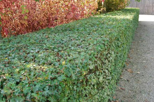
(*Acer campestre*)

Se ami i giardini naturali e vuoi allontanarti dalla solita siepe tutta uguale, l'acero campestre è una scelta meravigliosa. È una pianta **autoctona, rustica e resistentissima** al freddo e ai terreni difficili. Essendo caducifoglio, in inverno lascia filtrare la luce, ma in autunno regala una spettacolare esplosione di foglie **giallo oro**.
* **Distanza di impianto:** 1 pianta al metro.
* **[Potatura](/news/quando-e-come-potare-le-siepi "come potare la siepe"):** a giugno e novembre.

---

### Arancio Trifogliato
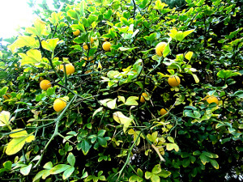
(*Citrus triptera* o *Poncirus trifoliata*)

Un agrume sorprendente che **non teme il gelo** degli inverni friulani. I suoi rami intrecciati e dotati di lunghe spine robuste lo rendono una barriera difensiva praticamente invalicabile. In marzo si riempie di fiori bianchi profumatissimi, seguiti in autunno da piccoli frutti gialli decorativi simili a limoni.
* **Distanza di impianto:** 1 pianta ogni 70 cm.
* **[Potatura](/news/quando-e-come-potare-le-siepi "come potare la siepe"):** ad aprile, subito dopo la fioritura (indossando guanti pesanti!).

---

### Biancospino
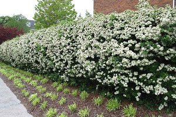
(*Crataegus monogyna*)

Protagonista delle siepi campestri tradizionali, il biancospino è ideale per chi desidera un giardino vivo che attiri **api, farfalle e uccellini**. Ad aprile si copre di una nuvola di fiori bianchi, mentre da settembre a dicembre si accende di bacche rosso brillante. Rustico e spinoso, forma ottime barriere naturali.
* **Distanza di impianto:** 1 pianta ogni 60 cm.
* **[Potatura](/news/quando-e-come-potare-le-siepi "come potare la siepe"):** a giugno e gennaio.

---

### Bosso
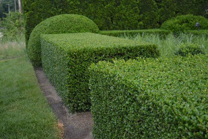
(*Buxus sempervirens*)

Il re indiscusso delle **siepi basse e formali**, perfetto per bordure geometriche e giardini all'italiana grazie al suo fogliame fitto e alla crescita lenta. **Un consiglio da esperto:** negli ultimi anni il bosso è spesso attaccato dalla *piralide del bosso* (un bruco che può spogliarlo in pochi giorni). Se scegli il bosso, tienilo monitorato in primavera ed estate; in alternativa, valuta il **Tasso** o l'*Ilex crenata*, che offrono lo stesso effetto elegante senza questo problema.
* **Distanza di impianto:** 1 pianta ogni 40 cm.
* **[Potatura](/news/quando-e-come-potare-le-siepi "come potare la siepe"):** a fine maggio, fine luglio e fine ottobre.

---

### Carpino Bianco
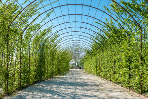
(*Carpinus betulus*)

Una delle mie scelte preferite per chi vuole una **siepe elegante, fitta e poco ingombrante** in larghezza. Pur non essendo un sempreverde in senso stretto, il carpino ha una caratteristica preziosa: in autunno le sue foglie diventano color bronzo dorato e **restano attaccate ai rami per tutto l'inverno**, garantendo privacy fino alla spuntata delle nuove gemme primaverili.
* **Distanza di impianto:** 1 pianta al metro.
* **[Potatura](/news/quando-e-come-potare-le-siepi "come potare la siepe"):** a metà giugno e a febbraio.

---

### Eleagno
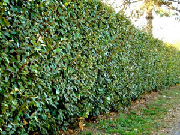
(*Elaeagnus x ebbingei*)

Una vera forza della natura, spesso sottovalutata. L'eleagno è un sempreverde robusto con foglie coriacee verde scuro sopra e argentate sotto. Resiste benissimo alla siccità, al caldo e **alla salsedine**, risultando perfetto anche per i giardini vicino al mare tra Grado e Monfalcone. A settembre nasconde tra le foglie piccoli fiori bianchi dal profumo dolcissimo.
* **Distanza di impianto:** 1 pianta ogni 70–80 cm.
* **[Potatura](/news/quando-e-come-potare-le-siepi "come potare la siepe"):** a giugno e a fine ottobre dopo la fioritura.

---

### Fillirea
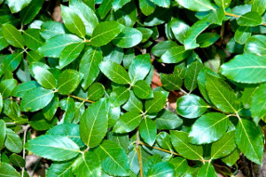
(*Phillyrea angustifolia*)

Arbusto sempreverde tipico della macchia mediterranea, molto apprezzato nei giardini moderni per la sua **chioma compatta e ordinata** che richiede poche potature. Ama il sole, sopporta bene la siccità estiva e si adatta molto bene alle zone miti e costiere dell'Isontino e della Bassa Friulana.
* **Distanza di impianto:** 1 pianta ogni 60 cm.
* **[Potatura](/news/quando-e-come-potare-le-siepi "come potare la siepe"):** a febbraio e dopo la fioritura a fine giugno.

---

### Fotinia
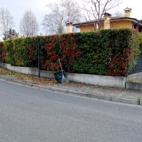
(*Photinia fraseri 'Red Robin'*)

È senza dubbio **la siepe più richiesta nei giardini privati**, e a ragione: cresce velocemente, copre bene la vista e in primavera regala spettacoli di colore grazie ai suoi nuovi germogli di un **rosso scarlatto brillante** che contrasta con il verde intenso delle foglie mature. Robusta, rustica e adatta a quasi tutti i terreni.
* **Distanza di impianto:** 1 pianta ogni 80 cm.
* **[Potatura](/news/quando-e-come-potare-le-siepi "come potare la siepe"):** dopo la fioritura primaverile e, per stimolare una seconda cacciata di foglie rosse, a fine settembre.

---

### Lauroceraso
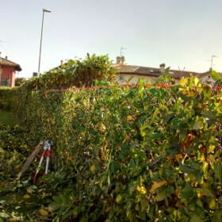
(*Prunus laurocerasus*)

Il grande classico delle siepi sempreverdi. Grazie alle sue foglie grandi, lucide e verde intenso, forma in poco tempo una barriera folta e coprente anche in presenza di mezz'ombra. Va però gestito con **potature regolari**: se lasciato crescere troppo in libertà, tende a diventare molto largo e a svuotarsi nella parte inferiore.
* **Distanza di impianto:** 1 pianta al metro.
* **[Potatura](/news/quando-e-come-potare-le-siepi "come potare la siepe"):** ai primi di giugno e a novembre.

---

### Ligustro
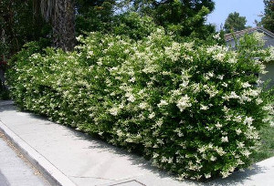
(*Ligustrum texanum* o *Ligustrum japonicum*)

Un sempreverde generoso, resistente allo smog urbano e facile da modellare. A fine maggio produce pannocchie di fiori bianchi molto profumati. È una valida alternativa al lauroceraso per chi cerca una foglia più piccola e un portamento leggermente più compatto.
* **Distanza di impianto:** 1 pianta ogni 70 cm.
* **[Potatura](/news/quando-e-come-potare-le-siepi "come potare la siepe"):** a fine giugno e a novembre.

---

### Osmanto
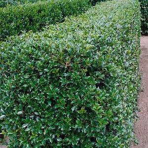
(*Osmanthus aquifolium* / *Osmanthus fragrans*)

Se desideri una **siepe elegante e profumatissima**, l'osmanto è un gioiello. Ha foglie lucide e coriacee (spesso leggermente spinose nelle varietà giovani, simili all'agrifoglio), cresce in modo ordinato senza richiedere tagli continui e tra settembre e ottobre sprigiona un profumo intenso e indimenticabile che avvolge tutto il giardino.
* **Distanza di impianto:** 1 pianta ogni 80 cm.
* **[Potatura](/news/quando-e-come-potare-le-siepi "come potare la siepe"):** a novembre, dopo la fioritura.

---

### Piracanta
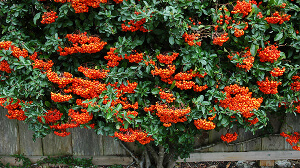
(*Pyracantha sp.*)

La soluzione migliore per chi cerca una **siepe antintrusione sempreverde**: i suoi rami fitti sono armati di spine lunghe e resistenti che scoraggiano qualsiasi malintenzionato. Oltre alla sicurezza, offre una grande bellezza: fiori bianchi ad aprile e grappoli ricchissimi di bacche rosse, arancioni o gialle che colorano il giardino fino a inverno inoltrato.
* **Distanza di impianto:** 1 pianta ogni 50 cm.
* **[Potatura](/news/quando-e-come-potare-le-siepi "come potare la siepe"):** a fine aprile (dopo la fioritura) e a settembre.

---

### Pitosporo
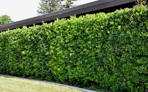
(*Pittosporum tobira*)

Arbusto sempreverde dal portamento arrotondato e foglie lucide. A giugno sbocciano fiori color crema dal profumo dolce che ricorda i fiori d'arancio. Soffre le gelate molto intense dell'entroterra, mentre dà il meglio di sé nelle zone più riparate, in città e lungo la costa isontina.
* **Distanza di impianto:** 1 pianta ogni 70–80 cm.
* **[Potatura](/news/quando-e-come-potare-le-siepi "come potare la siepe"):** a fine giugno dopo la fioritura, con eventuale ritocco leggero a febbraio.

---

### Cipresso di Leyland
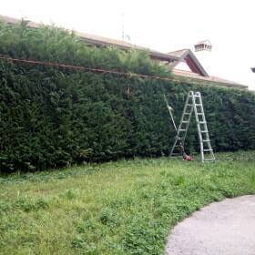
(*Cupressocyparis leylandii*)

La conifera più veloce in assoluto per creare **alte barriere frangivento e schermature totali**. La varietà migliore che consiglio è la **Leighton Green**, più elegante e compatta. **Attenzione però:** il Leylandii ha una crescita esplosiva e non ricaccia dal legno vecchio se potato troppo drasticamente; va quindi tagliato con regolarità ogni anno fin da giovane per mantenerlo snello e sano.
* **Distanza di impianto:** 1 pianta ogni 80–100 cm.
* **[Potatura](/news/quando-e-come-potare-le-siepi "come potare la siepe"):** a fine inverno e ritocco leggero a fine estate.

---

### Rosmarino
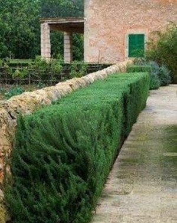
(*Rosmarinus officinalis*)

Perfetto per creare **siepi basse, profumate e a bassissima manutenzione** lungo vialetti, muretti o vicino alla zona barbecue. Ama il pieno sole, non teme la siccità, regala piccoli fiori azzurri già a fine inverno ed è sempre pronto per essere raccolto in cucina.
* **Distanza di impianto:** 1 pianta ogni 50 cm.
* **[Potatura](/news/quando-e-come-potare-le-siepi "come potare la siepe"):** dopo la fioritura primaverile e ritocco leggero a fine agosto (evitando di tagliare sui rami troppo legnosi).

---

### Viburno Tino (Lentaggine)
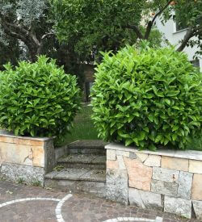
(*Viburnum tinus*)

Un grande protagonista dei giardini mediterranei e friulani. Il viburno tino è un sempreverde compatto e affidabile che ha il pregio di **fiorire in pieno inverno** (da gennaio a marzo) con graziosi mazzetti di fiori bianchi e boccioli rosati, seguiti in autunno da bacche blu metallico.
* **Distanza di impianto:** 1 pianta ogni 60–70 cm.
* **[Potatura](/news/quando-e-come-potare-le-siepi "come potare la siepe"):** a fine giugno, dopo la fioritura.

---

## Altre tre ottime soluzioni da considerare

Oltre alle varietà classiche appena viste, nel mio lavoro propongo spesso altre tre opzioni molto interessanti in base alle esigenze dello spazio:

* **Tasso (*Taxus baccata*):** Il "re" delle siepi sempreverdi di pregio. Cresce lentamente, sopporta benissimo l'ombra, ha un verde scurissimo ed elegante e — a differenza del leylandii — ricaccia anche dal legno vecchio. Ideale per chi cerca una siepe di altissimo livello che dura decenni.
* **Tuja (*Thuja occidentalis*):** Molto usata per creare pareti verdi strette e ordinate, occupando meno spazio in larghezza rispetto al lauroceraso.
* **Bambù non invasivo (*Fargesia*):** Per chi desidera un tocco moderno e zen senza il rischio che le radici invadano il giardino del vicino (a differenza del *Phyllostachys*, la *Fargesia* forma cespi ordinati e non è infestante).

---

## Vuoi un consiglio per la tua siepe o devi metterla a dimora?

Ogni giardino ha la sua esposizione, il suo terreno e le sue regole di confine. Se stai pensando di piantare una nuova siepe nelle province di **Udine e Gorizia**, posso aiutarti a scegliere le piante migliori in vivaio, preparare il terreno con la giusta concimazione, posare l'ala gocciolante e metterle a dimora a regola d'arte.

* Scopri le piante disponibili nel mio [Vivaio: vendita aceri, ulivi e piante da siepe](/vivaio/ "Vivaio: vendita aceri, ulivi, e piante da siepe").
* Hai già una siepe che ha bisogno di cure? Guarda come lavoro nella pagina dedicata alla [potatura siepi a Udine e Gorizia](/servizi/potatura-siepi/).
