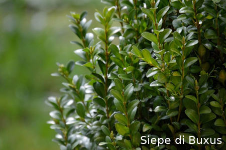
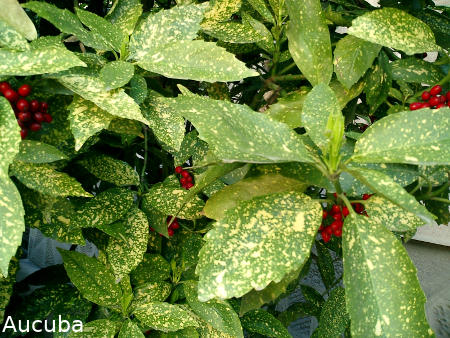
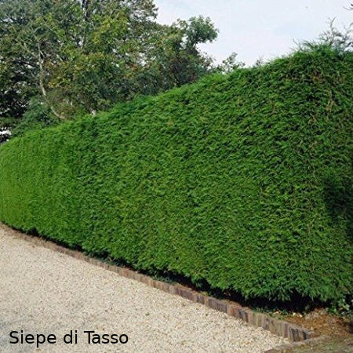
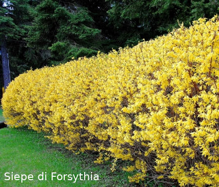

Potare una siepe può sembrare un lavoro semplice, quasi meccanico: si accende il tagliasiepi e si va dritti lungo il filo. In realtà, dietro una siepe folta, verde fino a terra e sana per decenni ci sono **conoscenze botaniche precise, tempistiche giuste e piccoli accorgimenti tecnici** che fanno tutta la differenza.

*Piacere, sono Enrico.* Nel mio lavoro con **Potasiepe** nelle province di **Udine e Gorizia**, la cura e la potatura delle siepi sono la mia specialità quotidiana. Spesso vengo chiamato per recuperare siepi ingiallite, svuotate nella parte bassa o indebolite da tagli eseguiti nel periodo sbagliato con lame non affilate.

In questa guida voglio condividere con te i segreti del mestiere per capire **quando e come intervenire** su ogni tipo di siepe.

---

## Tre regole d'oro prima di accendere il tagliasiepi

Prima ancora di guardare il calendario, ci sono tre principi tecnici che applico su ogni siepe che curo:

1. **La forma a trapezio (il segreto per non svuotarla alla base):** Una siepe non andrebbe mai tagliata perfettamente verticale come un muro, ma **leggermente più larga alla base e più stretta in cima**. In questo modo i raggi del sole raggiungono anche i rami più bassi, evitando che la siepe perda foglie ai piedi e diventi spoglia.
2. **Lame affilate e disinfettate:** Un tagliasiepi con lame consumate non taglia, ma "strappa" e sfilaccia i tessuti vegetali, lasciando antiestetiche punte secche e aprendo la porta a funghi e batteri. Inoltre, disinfettare le lame tra un giardino e l'altro evita di trasmettere malattie pericolose.
3. **Rispetto per la fauna in primavera:** Tra aprile e giugno molti uccellini nidificano nel fitto delle siepi. Prima di ogni intervento primaverile controllo sempre con attenzione l'interno della vegetazione per non disturbare eventuali nidi.

---

## Siepi sempreverdi (Lauroceraso, Fotinia, Bosso, Tasso)

Le [siepi sempreverdi](/news/siepe-quale-scegliere/ "scopri le caratteristiche della siepe") sono il cuore della maggior parte dei giardini privati e richiedono, in genere, **due interventi l'anno** per restare compatte e ordinate:

* **Prima potatura (fine maggio – giugno):** Si interviene dopo la prima spinta vegetativa primaverile (e dopo l'eventuale fioritura, come nel caso della fotinia o del ligustro) per dare forma e infoltire la chioma.
* **Seconda potatura (settembre – ottobre):** È il taglio di mantenimento più importante prima dell'inverno. Nel nostro clima friulano consiglio di **non andare oltre fine ottobre**, così i nuovi germogli hanno il tempo di lignificare e irrobustirsi prima delle gelate invernali.

Fanno eccezione le specie a crescita molto lenta come il **bosso** (*Buxus*) e il **tasso** (*Taxus baccata*), che mantengono la forma molto a lungo: sul tasso spesso basta un solo intervento ben fatto a fine estate, mentre il bosso può richiedere un leggero ritocco estivo se desideri geometrie impeccabili.

*Nota sulle piante a foglia grande:* Per essenze come il **lauroceraso** o l'**aucuba**, quando la siepe è giovane o si vuole un risultato estetico superiore, preferisco rifinire i rami più grossi con le **cesoie manuali** anziché tranciare a metà le foglie grandi con il tagliasiepi, evitando così bordi marroni antiestetici.

---

## Conifere (Cipresso di Leyland e Tuja)

I [cipressi di Leyland](/news/siepe-quale-scegliere/ "scopri le caratteristiche della siepe") e le **tuje** sono molto vigorosi e formano muri verdi fittissimi, ma nascondono un'insidia che molti non conoscono: **non ricacciano dal legno vecchio**.

* **Quando potarle:** Ideale intervenire tra **aprile e maggio** e fare un secondo passaggio leggero a **settembre**, evitando i mesi più caldi di luglio e agosto (quando il sole forte può bruciare i tagli freschi) e i mesi gelidi.
* **Come potarle:** Bisogna tagliare ogni anno mantenendosi sempre sulla parte verde esterna. Se una siepe di leylandii viene lasciata allargare troppo per anni, non si può poi "abbassare" o restringere drasticamente tagliando fino ai rami marroni interni, perché resterebbe spoglia per sempre.

---

## Siepi formali e siepi informali: due approcci diversi

Non tutte le siepi devono sembrare scolpite con il righello. La tecnica cambia in base allo stile del tuo giardino:

* **Siepi formali:** Composte solitamente da una sola specie (come tasso, bosso, carpino o fotinia), vengono modellate con linee geometriche nette. Qui la precisione del taglio, l'uso di guide o livelle e la regolarità degli interventi sono fondamentali.
* **Siepi informali (o miste):** Composte da arbusti diversi lasciati crescere in modo più morbido e naturale, spesso con fioriture scalari. In questo caso il tagliasiepi si usa pochissimo: si interviene **una volta l'anno con forbici e troncarami** per eliminare i rami secchi, sfoltire i punti troppo fitti e contenere l'ingombro senza mortificare il portamento naturale delle piante.

---

## Siepi fiorite: occhio a non tagliare i boccioli!

Uno degli errori più comuni che vedo nei giardini è potare tutte le siepi in autunno o a fine inverno. Se lo fai su una siepe fiorita sbagliata, **elimini tutte le gemme da fiore** dell'anno successivo!

Bisogna distinguere due grandi famiglie:

1. **Siepi che fioriscono in primavera sul legno dell'anno precedente** (*Forsythia*, *Spiraea*, *Deutzia*, *Viburno*): vanno potate **subito dopo la fioritura primaverile** (tra aprile e maggio). Così la pianta avrà tutta l'estate per produrre i nuovi rami che fioriranno la primavera seguente.
2. **Siepi che fioriscono in estate o autunno sul legno nuovo** (*Abelia*, *Buddleja*, *Ibisco*, *Lavanda*, *Eleagno*, *Osmanto*): sopportano una potatura di formazione a **fine inverno** (febbraio–marzo) oppure una spuntatura leggera **dopo la fioritura autunnale**, a seconda della specie.

---

## Siepi decidue (Carpino bianco e Acero campestre)

Le siepi a foglia caduca come il [carpino bianco](/news/siepe-quale-scegliere/ "scopri le caratteristiche della siepe") e l'**acero campestre** sono meravigliose perché cambiano aspetto con le stagioni.

* **Potatura estiva (metà giugno):** Serve a dare ordine e stimolare la ramificazione laterale.
* **Potatura invernale (febbraio, prima della ripresa vegetativa):** Nel caso del carpino bianco, aspettare la fine dell'inverno ti permette di godere per tutto l'autunno e l'inverno delle sue foglie color bronzo che restano attaccate ai rami, continuando a proteggere la tua privacy anche nei mesi freddi.

---

## La tua siepe è troppo alta, trascurata o ha bisogno di manutenzione?

Potare una siepe alta in sicurezza richiede scale stabili, piattaforme o attrezzature telescopiche professionali, oltre a un grande lavoro di raccolta e smaltimento delle ramaglie.

Se abiti nelle province di **Udine e Gorizia** (entro 30 km da Palmanova), me ne occupo io personalmente: utilizzo **tagliasiepi professionali a batteria silenziosi e senza fumi** per rispettare la quiete tua e dei tuoi vicini, e a fine lavoro lascio il giardino perfettamente pulito.

Scopri come lavoro e guarda le foto dei miei interventi nella pagina dedicata al servizio di [potatura siepi a Udine e Gorizia](/servizi/potatura-siepi/).
