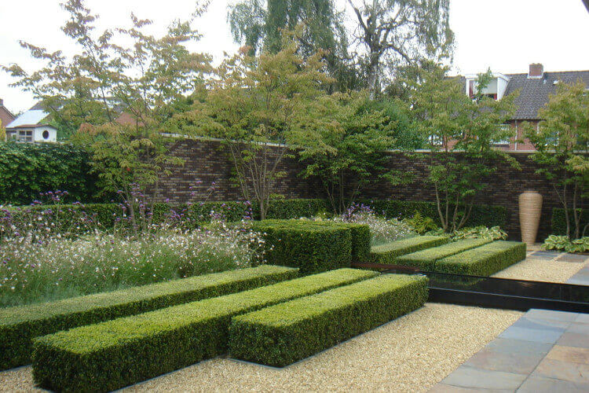
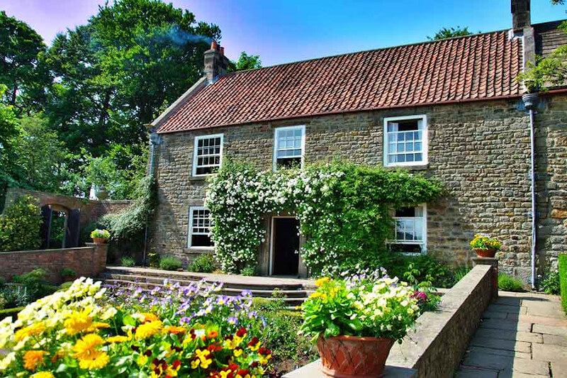
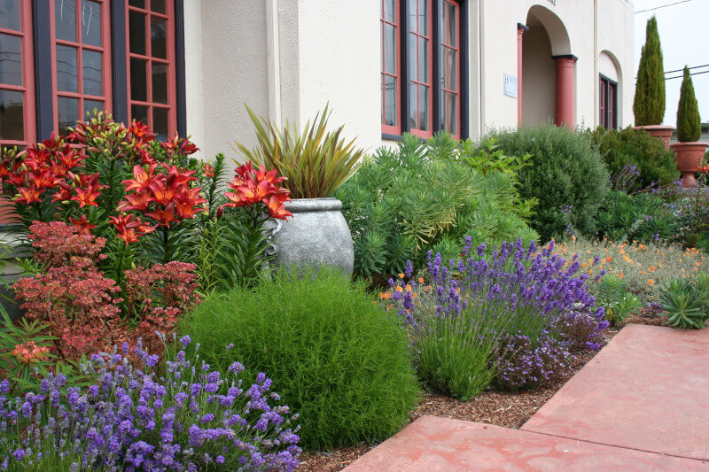
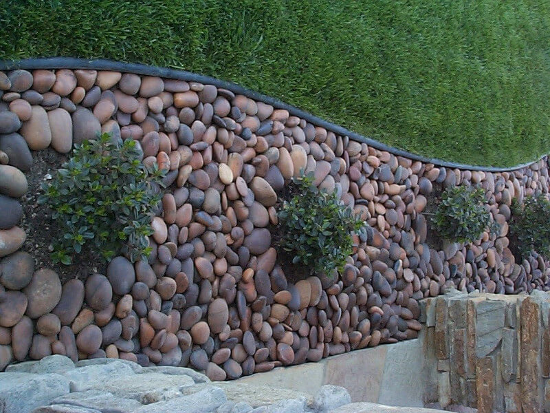
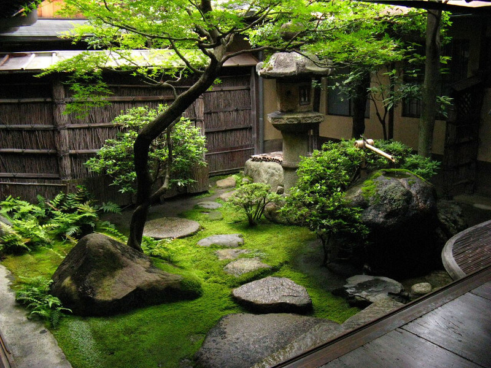
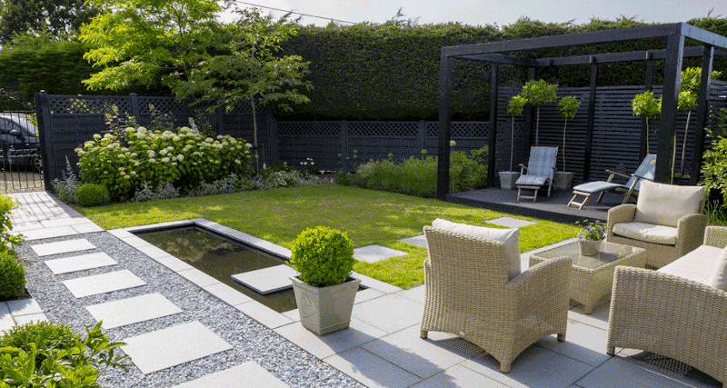
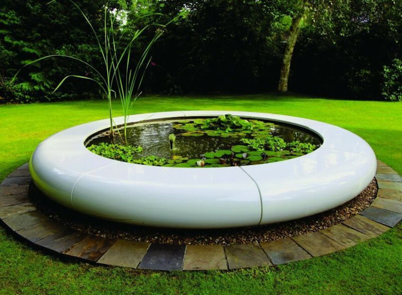
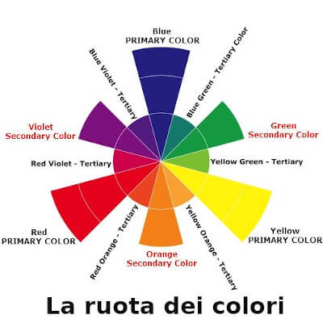

## Stili di giardini
Esistono molti stili di giardini ma per [ottenere il massimo](/servizi/progettazione-giardini/ "progettazione giardini - garden designer") dai vostri spazi verdi dovete scegliere
quello che meglio si adatta al vostro stile di vita e alla vostra casa.

### Stile giardino formale

Lo stile formale, tipico dei **giardini all'italiana**, presenta simmetrie e geometrie ben equilibrate. La vegetazione è disciplinata lungo le linee rigorose di muri, viali e terrazze. Tradizionalmente vengono impiegate poche piante diverse, usate però in abbondanza per ottenere uniformità nella tessitura e nei colori.

### Stile giardino informale

I giardini informali danno l'impressione di essere stati creati spontaneamente dalla natura. Le linee irregolari e morbide conferiscono a questi giardini un aria vagamente "spettinata". In realtà, la loro bellezza dipende da un progetto ben studiato e dalla capacità del giardiniere di mantenere l'ordine nella composizione. I **cottage garden** delle campagne inglesi ne sono un classico esempio.

### Giardini mediterranei

I giardini mediterranei possono essere creati sia in stile formale che informale.

In quelli formali saranno presenti acqua e pietre ma anche siepi potate ed esemplari unici di alberi, ad esempio cipressi e ulivi. In alcuni giardini della Spagna, come l'Alhambra a Granada, la forte influenza moresca si riflette in cortili formali ed elementi acquatici.

Lo stile più accessibile per un giardino mediterraneo ha però una struttura informale e un'atmosfera rilassata. Il principale materiale duro è la ghiaia, usata per collegare fra loro aiuole e vialetti. Spesso le piante hanno foglie argentate, verde salvia e sfumate di azzurro, che riflettono il forte sole estivo. Piante comuni sono gli olivi, gli agrumi, i fichi, la vite, le santoline e le artemisie, ma anche piante aromatiche come timo, salvia, lavanda e rosmarino.

### Giardini rocciosi

Gli appassionati di giardinaggio che desiderano coltivare un'ampia varietà di piante in uno spazio limitato o che vivono in una zona poco piovosa, potrebbero voler creare un giardino particolare con rocce e pietre.

Molti di questi giardini imitano la natura d'alta montagna o il terreno cotto dal sole del deserto. Che si tratti di un classico giardino roccioso, di un'aiuola di ghiaia o di un'area pavimentata costellata di piante striscianti aromatiche e succulente, le soddisfazioni per gli appassionati sono assicurate.

### Giardini giapponesi

Il giardino in <a href="https://it.wikipedia.org/wiki/Giardino_giapponese" aria-label="approfondisci l'argomento giardino giapponese su Wikipedia" target="_blank" rel="nofollow noopener">stile giapponese</a> è progettato per creare spazi tranquilli, contemplativi, che rispecchiano il paesaggio naturale con un numero limitato di piante. Il segreto per realizzare uno schema del genere è valutare il rapporto reciproco fra gli elementi principali - massi, ghiaia e piante - e la loro connessione simbolica e spirituale con il mondo naturale.

Le composizioni sempreverdi sono spruzzate di colori stagionali: ciliegi in fiore e camelie in primavera, eleganti iris estivi e chiome di aceri fiammeggianti in autunno.

### Giardini contemporanei

I giardini moderni e urbani possono assumere diversi ruoli: uno spazio dove far crescere le piante, rilassarsi, giocare e divertirsi. Sono spazi funzionali in cui prevalgono le superfici solide e l'arredamento, gli effetti luce e gli elementi acquatici.

La configurazione di un giardino urbano si basa di solito su linee semplici, spesso a pianta asimmetrica, con materiali naturali che si combinano con quelli artificiali, come cemento, vetro, plastica, plexiglas e acciaio che forniscono interesse strutturale.

L'arredamento consiste in panche integrali, coordinate elegantemente a tavoli, sedie e sdraio, mentre le sculture, talora abbinate all'acqua, costituiscono punti focali. Sono comuni zampilli e cascate ma anche specchi d'acqua ferma.

Negli schemi contemporanei sono comuni graminacee, bambù e piante a foglia larga. Come punti focali si possono usare contenitori d'effetto che ospitano il bosso topiario, l'alloro e l'agrifoglio giapponese. Alberi a spalliera piantati lungo i confini riparano alla vista i piani superiori.

### Giardini acquatici

Potreste voler popolare di piante una minuscola vasca in un patio oppure un laghetto artificiale. Le piante acquatiche sono quelle piante che crescono con le radici nell'acqua, sommerse o galleggianti.

L'ideale sarebbe creare profondità differenti e inserire le piante in cestini riempiti con terriccio per acquatiche. Va introdotta una varietà equilibrata di piante acquatiche e palustri per regolare la quantità di luce, ossigeno e nutrienti, mantenendo così l'acqua pulita.

Le piante sommerse come il *ceratofillo* sono chiamate "ossigenatori". Essi purificano l'acqua consumendo i nutrienti e schermando la luce, che provoca la crescita delle alghe. Anche le piante galleggianti in superficie, come il giacinto d'acqua, riducono la concentrazione di nutrienti assorbendoli con le radici sottili. Oltre a essere belle da vedere, le piante da acque profonde, come *Nuphar* e ninfee, con le radici sul fondo dello stagno e fiori e foglie in superficie, forniscono riparo agli animali che vivono nello stagno e limitano la crescita delle alghe.

## Valutare la posizione e il terreno
Prima di iniziare a progettare e mettere a dimora le piante, è importante analizzare il terreno e valutare quanto sole e ombra riceve il giardino.

### Capire l'esposizione
Usate una bussola per calcolare il punto cardinale verso cui sono rivolti gli spazi e le bordure: quelli a sud avranno il sole per la maggior parte della giornata, quelli a nord, invece, saranno in ombra; le zone rivolte a est hanno il sole la mattina e ombra la sera, quelli a ovest il contrario.

---
title: "Come progettare un giardino: idee, stili e consigli pratici"
excerpt: "Sogni un giardino bello da vivere tutto l'anno? Scopri come scegliere lo stile giusto, valutare sole e terreno e trasformare le tue idee (anche da app o IA) in un progetto reale."
image: /img/posts/giardini/progettazione-giardini-contemporanei.jpg
image_featured: true
last_modified_at: 2026-11-18T08:30:00+01:00
---

Progettare un giardino non significa semplicemente scegliere qualche bella pianta in vivaio e metterla a dimora. Significa immaginare come vivrai quello spazio nei prossimi anni: dove berrai il caffè al mattino, dove farai giocare i bambini o i cani, come proteggere la tua privacy dai vicini e quanto tempo avrai davvero voglia di dedicare alla manutenzione.

*Piacere, sono Enrico.* Nel mio lavoro tra le province di **Udine e Gorizia** incontro ogni settimana persone con un desiderio comune: trasformare un pezzo di terra vuoto — o un giardino ormai disordinato — in un luogo accogliente, armonioso e facile da gestire.

In questa guida voglio accompagnarti passo dopo passo tra gli stili e le scelte fondamentali per dare forma al tuo spazio verde, mettendo insieme la bellezza che sogni e la praticità che serve nella vita di tutti i giorni.

---

## Parti dalle tue idee (anche con una bozza su carta, app o IA)

Non serve essere architetti paesaggisti per iniziare a sognare il proprio giardino. Negli ultimi anni mi capita sempre più spesso di incontrare clienti che si divertono a disegnare una prima bozza su un foglio, usando un'app di design oppure chiedendo aiuto all'intelligenza artificiale.

**È un ottimo punto di partenza.** Vedere una tua bozza mi aiuta a capire subito i tuoi gusti, i colori che ami e come immagini gli spazi. Il mio compito, durante il sopralluogo, è prendere quella tua visione e renderla **realmente fattibile**: verifico che le piante scelte resistano agli inverni friulani o al vento dell'Isontino, calcolo le giuste distanze di crescita (per evitare che tra cinque anni un albero soffochi la siepe) e predispono per tempo gli impianti di irrigazione.

Se vuoi vedere con i tuoi occhi come prendono forma queste idee sul campo, guarda questo breve video su come nasce un giardino:

  <iframe src="https://youtube.com" title="Come nasce un giardino - Potasiepe" style="position: absolute; top: 0; left: 0; width: 100%; height: 100%; border: 0;" allow="accelerometer; autoplay; clipboard-write; encrypted-media; gyroscope; picture-in-picture" allowfullscreen></iframe>

---

## Scegli lo stile più adatto alla tua casa e al tuo tempo

Ogni giardino racconta qualcosa di chi lo abita. Prima di scegliere le piante, chiediti che atmosfera vuoi respirare quando apri la finestra di casa. Ecco gli stili più apprezzati e cosa comportano nella gestione quotidiana.

### Stile formale (ordine e geometria)

Ispirato ai classici giardini all'italiana, punta tutto su **simmetria, linee pulite e siepi squadrate**. Si usano poche varietà di piante ripetute con regolarità lungo vialetti e muretti. È perfetto se ami l'ordine assoluto e le architetture moderne, ma richiede **potature puntuali** per mantenere le forme sempre impeccabili.

### Stile informale (naturale e accogliente)

È il giardino che sembra nato spontaneamente, con **bordure morbide, aiuole fiorite e accostamenti ricchi di colore**. Dietro quell'aspetto rilassato c'è in realtà uno studio attento delle altezze e dei periodi di fioritura, così da avere sempre qualcosa di vivo da primavera all'autunno senza un aspetto trascurato.

### Giardino mediterraneo (profumi e resistenza al caldo)

Ideale per chi ama i colori caldi, i vialetti in ghiaia e le piante che non temono il sole estivo. **Ulivi, lavanda, rosmarino, salvia, timo e santolina** regalano profumi meravigliosi e fogliami dalle sfumature argentate. Ha il grande vantaggio di richiedere **poca acqua** una volta che le piante hanno radicato bene.

### Giardino roccioso (ideale per spazi piccoli o in pendenza)

Se hai un'aiuola molto soleggiata, un dislivello o un terreno particolarmente sassoso, pietre naturali abbinate a **piante tappezzanti, aromatiche e succulente** creano un angolo scenografico di grande carattere e a bassissima manutenzione.

### Giardino giapponese (quiete e contemplazione)

Un piccolo rifugio di pace basato sull'equilibrio tra **pietra, acqua e poche piante selezionate con cura**, come aceri giapponesi, camelie, azalee e muschi. È lo stile perfetto per un angolo raccolto vicino al portico, dove staccare la spina a fine giornata.

### Giardino contemporaneo (design e convivialità)

Pensato come un vero salotto all'aperto, unisce il verde a **materiali moderni come acciaio corten, legno, pietra e giochi di luce**. Le piante protagoniste sono spesso graminacee ornamentali (che si muovono eleganti al vento), bambù non invasivi e arbusti sempreverdi a foglia larga, facili da gestire anche per chi ha poco tempo.

### Angoli d'acqua e laghetti ornamentali

Anche una piccola vasca su un terrazzo o un laghetto in giardino cambia completamente l'atmosfera, portando il suono rilassante dell'acqua e attirando farfalle e piccoli uccelli. Combinando piante ossigenanti sul fondo e ninfee in superficie, l'acqua resta pulita e limpida in modo naturale.

---

## Tre regole pratiche prima di piantare

Al di là dello stile che preferisci, ci sono tre aspetti tecnici che determinano se un giardino crescerà rigoglioso o diventerà una fonte continua di problemi:

1. **Osserva il sole durante la giornata:** Una bordura esposta a sud riceve sole pieno tutto il giorno e ha bisogno di piante resistenti alla siccità; una fascia a nord, all'ombra della casa, richiede specie da mezz'ombra come ortensie, hosta o felci.
2. **Conosci il tuo terreno:** In Friuli passiamo dai terreni ghiaiosi e molto drenanti dell'alta pianura ai suoli più argillosi e compatti verso la costa. Prima di mettere a dimora qualsiasi pianta, arricchire il suolo con **compost maturo o sostanza organica** fa tutta la differenza del mondo per la salute delle radici.
3. **Crea interesse nelle quattro stagioni:** Non scegliere solo piante che esplodono a maggio per poi restare spoglie tutto l'anno. Alterna **sempreverdi** per dare struttura in inverno, **bulbose e alberi da fiore** per la primavera, **perenni e graminacee** per l'estate e arbusti come **aceri o cornus** che si accendono di rosso e arancio in autunno.

---

## Giocare con i colori per cambiare la percezione dello spazio

Il colore dei fiori e delle foglie non serve solo a decorare, ma guida l'occhio e influenza l'umore di chi vive il giardino:

* **Toni caldi (rosso, arancio, giallo oro):** portano energia e allegria. Sono perfetti vicino alla zona pranzo o al barbecue, ma usali con equilibrio perché attirano subito lo sguardo.
* **Toni freddi (blu, viola, rosa pallido, bianco):** trasmettono calma e freschezza. Hanno anche un trucco visivo utile: se posizionati in fondo a un giardino piccolo, **creano profondità e fanno sembrare lo spazio più grande**.
* **Abbinamenti armonici o a contrasto:** accostare sfumature vicine (come blu, lilla e rosa) crea un effetto elegante e rilassante; mettere vicino colori opposti (come il viola della lavanda e il giallo delle achillee) dà invece una scossa di vitalità a tutta l'aiuola.

---

## Vuoi trasformare la tua idea in un giardino reale?

Che tu abbia già una bozza disegnata da te o solo tanta voglia di rinnovare lo spazio intorno a casa, posso aiutarti a progettare e realizzare un giardino su misura, completo di impianto di irrigazione, pacciamatura anti-erbacce e prato pronto da vivere.

Scopri come lavoro nella pagina dedicata al servizio di [progettazione e realizzazione giardini a Udine e Gorizia](/servizi/progettazione-giardini/) oppure [contattami per un sopralluogo gratuito](/contatti/): cammineremo insieme nel tuo giardino per trovare la soluzione più bella e pratica per te.
