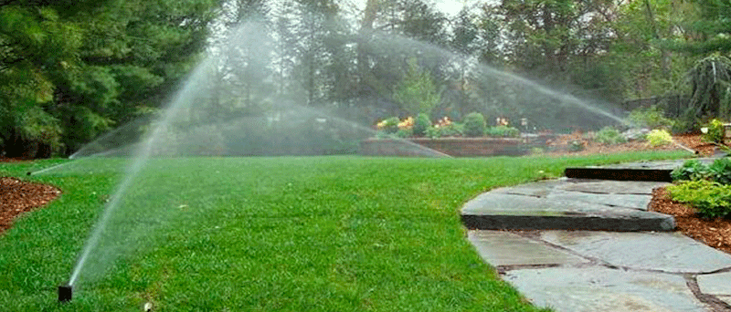
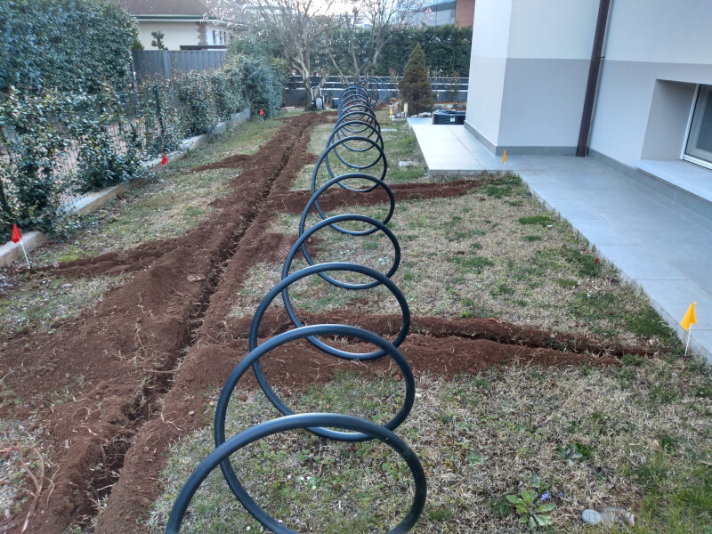

# Impianti di irrigazione giardino a Udine e Gorizia

**Progettazione, installazione e manutenzione di sistemi automatici su misura (entro 30 km da Palmanova)**

Un impianto di irrigazione ben progettato ti libera dall'impegno quotidiano di bagnare a mano, **riduce gli sprechi d'acqua fino al 40–50%** e mantiene il prato e le piante sempre verdi anche durante le estati più calde.

 

 

*Piacere, sono Enrico.* Con **Potasiepe** mi occupo personalmente della **realizzazione, riparazione e manutenzione di impianti di irrigazione** per giardini privati, terrazzi e aziende nelle province di **Udine e Gorizia**.

Per garantirti durata e affidabilità nel tempo, utilizzo esclusivamente componenti professionali **Hunter e Rain Bird**. Mi aggiorno costantemente tramite webinar tecnici sui nuovi prodotti e partecipo ogni anno a corsi pratici sul campo insieme ad altri colleghi giardinieri e idraulici, testando dal vivo le ultime novità su centraline, elettrovalvole, irrigatori e raccordi.

---

## Perché affidarsi a uno specialista del verde e dell'idraulica

In molti anni di interventi su impianti realizzati da altri, ho riscontrato spesso due problemi opposti:

* **Impianti fatti da soli idraulici:** pur essendo ben collegati dal punto di vista idraulico, spesso non tengono conto delle diverse esigenze idriche tra prato, siepi e alberi, né dell'esposizione al sole o all'ombra delle varie zone del giardino.
* **Impianti fatti da giardinieri improvvisati:** vengono spesso montati in modo approssimativo, senza un corretto calcolo di pressioni e portate, causando zone secche o ristagni d'acqua.

Un impianto davvero efficace nasce solo dall'unione tra **competenze idrauliche** e **conoscenze botaniche e agronomiche**: ogni specie vegetale riceve esattamente la quantità d'acqua di cui ha bisogno, nel momento migliore della giornata.

---

## Tipologie di impianti che realizzo

* **Irrigazione interrata a scomparsa per prati:** Irrigatori dinamici e statici calibrati per coprire ogni angolo del tappeto erboso in modo uniforme, senza zone secche né ristagni d'acqua.
* **Irrigazione a goccia per siepi, aiuole e orti:** Ala gocciolante mirata alle radici che nutre siepi e fioriere senza bagnare le foglie, prevenendo così malattie fungine e consumando pochissima acqua.
* **Sistemi per terrazzi e fioriere:** Impianti discreti e automatizzati per mantenere rigogliose le piante in vaso anche quando sei in vacanza.
* **Centraline intelligenti e sensori pioggia:** Programmatori facili da usare (anche gestibili da smartphone) collegati a sensori pioggia o umidità che bloccano automaticamente l'irrigazione quando non serve.

 

<picture>
  <source srcset="/img/prodotti/webp/scavo-irrigazione-giardino.webp" type="image/webp">
  <source srcset="/img/prodotti/scavo-irrigazione-giardino.jpg" type="image/jpeg">
  
</picture>

 

## Scavi puliti e pozzetti costruiti per durare nel tempo

Uno dei timori più frequenti di chi ha già un bel giardino è che lo scavo per i tubi distrugga il prato. Grazie all'utilizzo di una **catenaria professionale**, realizzo **trincee strette, profonde e precisissime**, riducendo al minimo l'impatto sul tappeto erboso e ripristinando subito il livello del terreno a fine posa.

Inoltre, dedico una cura particolare alla **realizzazione dei pozzetti delle elettrovalvole**: troppo spesso vedo pozzetti chiusi o interrati in modo tale da rendere impossibile una futura manutenzione senza dover demolire e scavare tutto intorno. Realizzare un pozzetto a regola d'arte e facilmente ispezionabile **costa uguale in fase di installazione**, ma ti permette di sostituire un componente in pochi minuti e con una spesa minima negli anni a venire.

---

## Check-up stagionale e manutenzione (da 50 € a 100 €)

Oltre a realizzare impianti nuovi, intervengo anche su impianti esistenti per **apertura primaverile, regolazione ugelli, pulizia filtri, chiusura invernale e ricerca guasti**, con pacchetti di controllo e messa a punto a partire da **50 € a 100 €** in base alle dimensioni dell'impianto.

---

## Dove lavoro

Realizzo e riparo impianti di irrigazione entro **30 km da Palmanova**, nelle province di [Udine](/impianti-irrigazione-giardino-udine/) e [Gorizia](/impianti-irrigazione-giardino-gorizia/).

 

<picture>
  <source media="(max-width:460px)" srcset="/img/prodotti/pozzetto-irrigazione-400x300.jpg">
  <source srcset="{{ page.webp }}" type="image/webp">
  <source srcset="{{ page.image }}" type="image/jpeg">
  
</picture>

