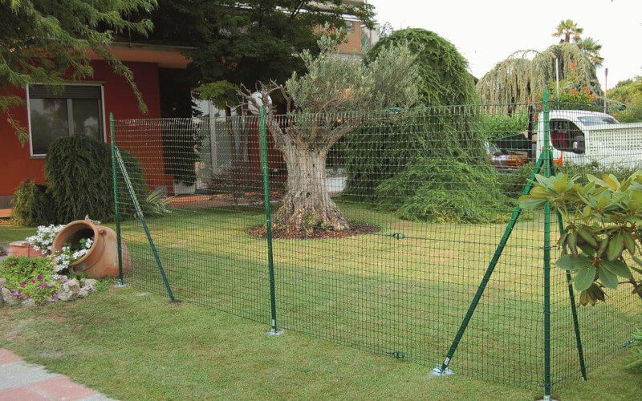
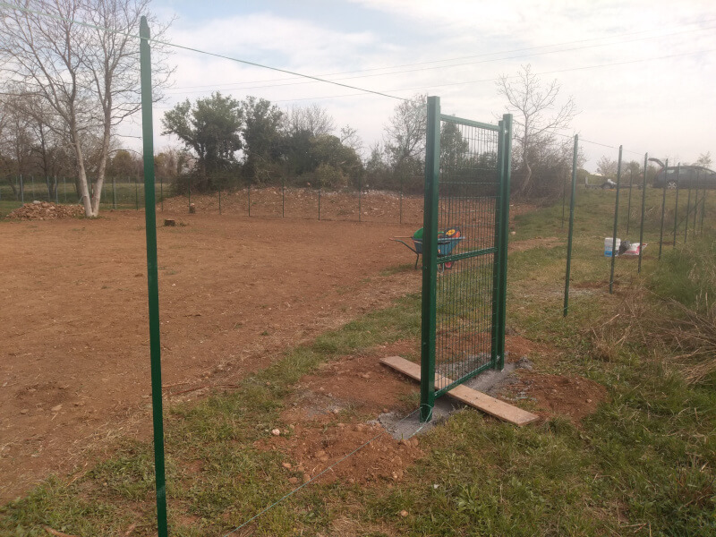

# Posa recinzioni in rete metallica, plastica e legno a Udine e Gorizia

**Delimitazioni su misura, solide e durature per giardini, terreni e proprietà private (entro 30 km da Palmanova)**

Una buona recinzione non serve solo a segnare un confine: protegge la tua privacy, mette in sicurezza bambini e animali domestici e mantiene ordinato il giardino nel tempo.

 

<picture>
  <source srcset="{{ page.webp }}" type="image/webp">
  <source srcset="{{ page.image }}" type="image/jpeg">
  
</picture>

 

*Piacere, sono Enrico.* Oltre alla cura del verde, mi occupo personalmente della **fornitura e posa di recinzioni chiavi in mano** nelle province di **Udine e Gorizia**. Realizzo recinzioni con rete metallica elettrosaldata o a maglia sciolta, rete plastificata atossica per animali, reti zincate, soluzioni in PVC per piante rampicanti, cancelletti pedonali e staccionate in legno.

---

## Costo posa recinzione rete metallica

Il prezzo finale dipende dall'altezza, dallo spessore del filo e dalle condizioni del terreno (presenza o meno di pali esistenti, pendenze o necessità di scavo).

Per darti un riferimento chiaro fin da subito, ecco una tabella indicativa di costo per **fornitura e posa di rete metallica plastificata elettrosaldata** (spessore 2,5 mm) su superficie livellata con pali di sostegno già presenti:

| Altezza rete | Costo indicativo al metro lineare |
| :--- | :--- |
| **100 cm** | € 20 / m |
| **125 cm** | € 22 / m |
| **150 cm** | € 23 / m |
| **175 cm** | € 27 / m |
| **200 cm** | € 31 / m |

*Nota: se servono anche la fornitura e la posa dei pali (in ferro o legno), lo spianamento o la rimozione di una vecchia rete, definiamo ogni voce in modo chiaro durante il sopralluogo.*

---

## Tipologie di recinzioni e interventi che realizzo

### Posa, innalzamento e riparazione di reti metalliche
Installo recinzioni nuove posando pali in ferro o legno e tendendo la rete a regola d'arte. Eseguo inoltre **sostituzioni totali o parziali** di vecchie reti arrugginite o danneggiate, oltre all'**innalzamento di recinzioni esistenti** con aggiunta o sostituzione di pali, fili di tensione e tendicavi.

### Recinzioni in rete di plastica: economica e forte come il ferro
Realizzo recinzioni con **rete in plastica ad alta resistenza** (maglia 33 × 48 mm) montata su pali in ferro o legno. Nata per non interferire con i campi elettromagnetici negli aeroporti, questa rete ha un aspetto molto simile al metallo e un'altissima resistenza a trazione, strappo e sfondamento.

 

<picture>
  <source srcset="/img/prodotti/webp/recinzione-rete-plastica-verde.webp" type="image/webp">
  <source srcset="/img/prodotti/recinzione-rete-plastica-verde.jpg" type="image/jpeg">
  
</picture>

 

**Costa meno di una recinzione in ferro** ed è la scelta ideale soprattutto nelle **zone di mare** (come Grado, Monfalcone o Lignano), perché è completamente inerte alla corrosione della salsedine.

### Staccionate e steccati in legno di pino e castagno
Eseguo interventi di posa, rinforzo e riparazione di **staccionate rustiche in legno** per delimitare proprietà, scarpate, sponde fluviali o collinari nel pieno rispetto dell'ambiente. Su richiesta tratto la testa e la porzione interrata dei pali con **catramina bituminosa liquida** per proteggerli dall'umidità del suolo e allungarne la durata negli anni.

---

## Servono permessi edilizi per posare una recinzione?

Per una **semplice recinzione con pali in legno o ferro e rete metallica senza opere murarie**, non è necessaria alcuna pratica edilizia (niente CILA, SCIA o permesso di costruire): rientra nel diritto di delimitare la propria proprietà privata per sicurezza.

Al contrario, la realizzazione di **muri di cinta, cordoli in calcestruzzo o basamenti murari** richiede un titolo edilizio (CILA, SCIA o permesso di costruire), in base alle dimensioni, alla tipologia e all'impatto sull'ambiente circostante secondo il regolamento del tuo Comune.

---

## Zona servita

Installo reti, cancelli pedonali e staccionate nelle province di **Udine e Gorizia**, nel **raggio di 30 km da Palmanova**.

 

<picture>
  <source srcset="/img/prodotti/webp/recinzione-posa-cancello-giardino.webp" type="image/webp">
  <source srcset="/img/prodotti/recinzione-posa-cancello-giardino.jpg" type="image/jpeg">
  
</picture>

