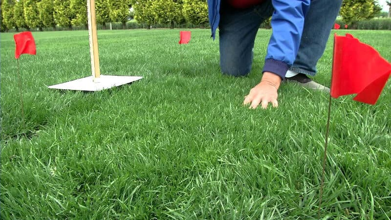

# Prato a Rotoli a Udine e Gorizia

**Vendita e posa di tappeto erboso in zolla pronto effetto (entro 30 km da Palmanova)**

 

  <picture>
  <source media="(max-width:460px)" srcset="{{ site.baseurl }}/img/prato/prato1-400x300.jpg">
  
  </picture>
  <picture>
  <source media="(max-width:460px)" srcset="{{ page.image_path }}">
  
  </picture>
  <picture>
  <source media="(max-width:460px)" srcset="{{ site.baseurl }}/img/prato/prato3-400x300.jpg">
  
  </picture>

 

*Piacere, sono Enrico.* Con **Potasiepe** mi occupo della **fornitura e posa completa di prato a rotoli** nelle province di **Udine e Gorizia**, selezionando zolle mature e resistenti per trasformare il tuo giardino in un tappeto verde uniforme in una sola giornata.

## Costo prato a rotoli

Di seguito i **prezzi indicativi del prato a rotoli** riferiti a un lavoro di **posa completa chiavi in mano**, comprensivo di:
✔ Dissodamento del terreno ✔ Smaltimento del materiale di risulta ✔ Livellamento del piano ✔ Rullatura ✔ Concimazione starter ✔ Fornitura prato a rotoli ✔ Posa.

| Dimensione giardino mq | Costo posa completa al mq |
| :--- | :--- |
| **Fino a 100 m²** | € 25,00 / m² |
| **Da 100 a 500 m²** | € 21,00 / m² |
| **Oltre 500 m²** | Prezzo da concordare |

* **Sola fornitura (trasporto e posa esclusi):** **€ 11,00 al m²** (ordine minimo 15 m²).
* **Dimensioni singolo rotolo:** 112 cm × 45 cm × 3 cm (circa 0,5 m² a rotolo).

## I vantaggi del prato a rotoli

Il prato a rotoli è uno dei migliori [tipi di prato](/news/i-migliori-semi-per-il-prato/ "tipi di prato") per chi desidera un risultato immediato e sicuro. I vantaggi del tappeto erboso in zolla rispetto a una semina tradizionale sono molti:

* **Immediatamente calpestabile:** Appena terminata la posa hai subito un giardino fruibile e ordinato, senza dover attendere mesi evitando di camminarci sopra.
* **Privo di erbacce:** Si tratta di un prato adulto e folto, coltivato in vivaio per 8–12 mesi con tagli e concimazioni regolari, che soffoca sul nascere le infestanti.
* **Posabile quasi tutto l'anno:** A differenza della semina, legata strettamente alla primavera e all'autunno, le zolle possono essere posate in gran parte dell'anno (esclusi i periodi di gelo intenso).

## Cura, concimazione e irrigazione dopo la posa

Per far radicare velocemente le zolle nel nuovo terreno ti consiglio di seguire questi semplici passaggi:

1. **Prime due settimane:** Annaffia abbondantemente **due volte al giorno** per mantenere sempre umido lo strato radicale.
2. **Dopo 2–3 settimane:** Esegui il **primo taglio** regolando il tagliaerba su un'altezza medio-alta.
3. **Dopo un mese:** Distribuisci una concimazione di mantenimento e riduci l'[irrigazione](/prodotti/irrigazione-giardino/) a **una volta al giorno** (o secondo la stagione).

 

<picture>
  <source srcset="/img/prato/webp/cura-prato-a-rotoli.webp" type="image/webp">
  <source srcset="/img/prato/cura-prato-a-rotoli.jpg" type="image/jpeg">
  
</picture>

