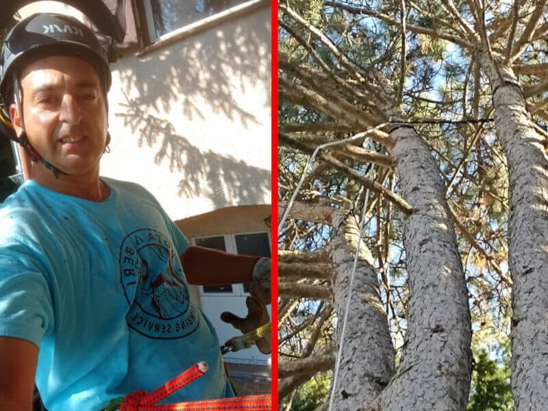
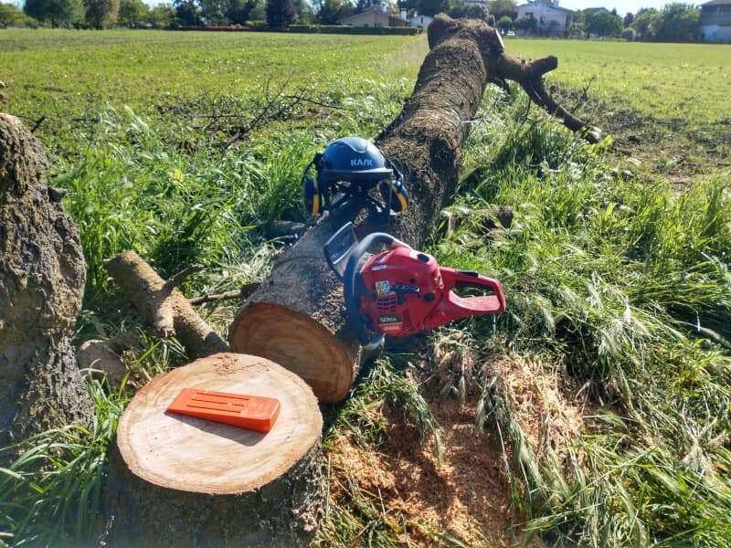

# Potatura e Abbattimento Alberi ad Alto Fusto a Palmanova, Udine e Gorizia

Hai un albero troppo alto vicino a casa, rami pericolanti dopo il maltempo o una pianta malata da rimuovere in sicurezza? **Potasiepe** interviene per la **potatura, la messa in sicurezza e l’abbattimento controllato di alberi ad alto fusto**, operando in un raggio di **30 km da Palmanova** (nelle province di Udine e Gorizia).

Lavorare sugli alberi richiede esperienza, attrezzature professionali e massima prudenza per non danneggiare tetti, recinzioni, impianti o il prato sottostante.

 

   
  <a title="Richiedi un sopralluogo gratuito" href="/contatti/" aria-label="Richiedi un sopralluogo gratuito" class="button">Richiedi un sopralluogo gratuito</a>

 

  <picture>
  <source media="(max-width:460px)" srcset="{{ site.baseurl }}/img/servizi/400x300/abbattimento.jpg">
  
  </picture>
  <picture>
  <source media="(max-width:460px)" srcset="{{ site.baseurl }}/img/servizi/400x300/smaltimento.jpg">
  
  </picture>
  <picture>
  <source media="(max-width:460px)" srcset="{{ site.baseurl }}/img/servizi/400x300/potatura-ornamentale-conifere-topiaria.jpg">
  
  </picture>

 

## Perché affidare i tuoi alberi a Potasiepe

* **Istruttore Qualificato Motosega:** Sono un istruttore certificato nell'uso della motosega. Per te significa avere in giardino un professionista che applica i più alti standard di sicurezza e precisione di taglio, azzerando i rischi per la tua proprietà.
* **Doppia tecnica (Cesta + Tree Climbing):** Utilizzo la **piattaforma aerea (cesta)** per intervenire con rapidità e contenere i costi, ma grazie al brevetto da **Tree Climber** posso sbarcare dalla cesta e muovermi direttamente in chioma per raggiungere i punti più interni o gli alberi situati in giardini dove i mezzi meccanici non possono entrare.
* **Potature rispettose della pianta:** Niente capitozzature selvagge che indeboliscono l'albero e lo rendono pericoloso negli anni successivi. Eseguo tagli mirati per mantenere la pianta sana, stabile ed esteticamente equilibrata.
* **Giardino pulito a fine lavoro:** Mi occupo personalmente dello smaltimento delle ramaglie (anche tramite camion con polipo o biotrituratore), lasciando il tuo spazio verde in perfetto ordine.

 

<picture>
  <source srcset="/img/servizi/webp/consolidamento-alberi-treeclimbing-potasiepe.webp" type="image/webp">
  <source srcset="/img/servizi/consolidamento-alberi-treeclimbing-potasiepe.jpg" type="image/jpg">
  
</picture>

 

## I nostri interventi sugli alberi

### 1. Potatura di alberi ad alto fusto e ornamentali

Interveniamo su pini, abeti, querce, tigli, aceri, pioppi, cedri e alberi da frutto di grandi dimensioni. Eseguiamo:

* **Rimonda del secco:** rimozione dei rami secchi o spezzati che rischiano di cadere con il vento.
* **Sfoltimento e alleggerimento della chioma:** per ridurre l'"effetto vela" durante i temporali e far filtrare più luce in giardino.
* **Contenimento controllato:** per allontanare i rami da facciate, grondaie, cavi elettrici o proprietà confinanti.
* **Processionaria:** per scongiurare il pericolo dei peli urticanti di questi lepidotteri, pericolosi per le persone, letali per gli animali domestici, rimuoviamo i [nidi di processionaria](/servizi/lotta-alla-processionaria/ "Rimozione nidi processionaria") che aggrediscono i vostri pini, cedri e querce.

### 2. Abbattimento alberi e abbattimento controllato

Quando un albero è morto, instabile o malato, procediamo alla sua rimozione in totale sicurezza:

* **Abbattimento al piede:** quando c'è spazio libero sufficiente per far cadere l'albero intero a terra in modo direzionato.
* **Abbattimento controllato (smontaggio in quota):** indispensabile nei giardini privati o vicino alle abitazioni. L'albero viene sezionato dall'alto verso il basso e i singoli pezzi vengono calati lentamente a terra tramite corde e frizioni, senza alcun impatto sul terreno o sulle strutture vicine.

### 3. Interventi urgenti post-maltempo e messa in sicurezza

Dopo forti raffiche di vento o temporali, interveniamo rapidamente per mettere in sicurezza alberi inclinati, rami spezzati rimasti impigliati in chioma o piante cadute.

 

<picture>
  <source media="(max-width:460px)" srcset="{{ page.image_path }}">
  <source srcset="{{ page.webp }}" type="image/webp">
  <source srcset="{{ page.image }}" type="image/jpeg">
  
</picture>

 

## Il nostro metodo: il vantaggio di Cesta e Tree Climbing insieme

Molti operatori lavorano solo con la piattaforma aerea o solo in arrampicata. Avere entrambe le competenze mi permette di scegliere la soluzione migliore per il tuo giardino:

1. **Con la piattaforma aerea (PLE)** lavoriamo in modo veloce, sicuro ed economico su alberi accessibili ai mezzi.
2. **Con lo sbarco in chioma e il Tree Climbing** entriamo dentro la chioma dell'albero anche nei cortili interni, sui terreni in pendenza o vicino a vetrate e tetti delicati, evitando di compattare o rovinare il prato con mezzi pesanti.

---

## Dove operiamo

Partendo dalla nostra base operativa vicino a **Palmanova**, copriamo rapidamente un raggio di **30-35 km**, intervenendo abitualmente nei comuni di:
**Palmanova, Udine, Cervignano del Friuli, Codroipo, Manzano, San Giovanni al Natisone, Cividale del Friuli, Buttrio, Pavia di Udine, Pozzuolo del Friuli, Gonars, Latisana, Aquileia, Grado, Gorizia, Gradisca d'Isonzo, Monfalcone, Cormons, Ronchi dei Legionari** e comuni limitrofi.

---

## Domande Frequenti (FAQ)

Servono permessi comunali per abbattere un albero nel mio giardino?
: Dipende dal regolamento del tuo Comune e dal tipo di pianta (alcuni alberi monumentali o di certe dimensioni sono tutelati). Durante il sopralluogo posso darti indicazioni pratiche su come verificare eventuali vincoli presso l'ufficio tecnico del tuo Comune.

Cosa succede a rami e tronchi dopo il taglio?
: Decidi tu. Possiamo caricare e portare via tutto il materiale di risulta tramite camion con polipo, triturare i rami sul posto con il biotrituratore per creare pacciamatura utile alle tue aiuole, oppure tagliare i tronchi in ciocchi pronti da spaccare se desideri tenere la legna da ardere.

Qual è il periodo migliore per potare gli alberi?
: Dipende dalla specie e dal tipo di intervento. Le rimonde del secco e le messe in sicurezza si possono fare tutto l'anno, mentre le potature più importanti si programmano in base al ciclo vegetativo della pianta per non stressarla.

Come viene calcolato il preventivo?
: Ogni albero è diverso per altezza, accessibilità e ostacoli circostanti. Per questo motivo offro un **sopralluogo gratuito e senza impegno**: valuto la situazione sul posto e ti fornisco un preventivo chiaro e definitivo.

---

## Richiedi un sopralluogo gratuito

Hai un albero da potare o abbattere nella zona di Palmanova, Udine o Gorizia? Contattami per fissare un sopralluogo gratuito.

* **Telefono:** [+39 388 9005888](tel:+393889005888)
* **WhatsApp:** [Scrivimi su WhatsApp](https://wa.me/393889005888) *(Puoi inviarmi direttamente un paio di foto dell'albero per una prima valutazione rapida!)*

 

   
  <a title="Contattami ora per un preventivo" href="/contatti/" aria-label="Contattami ora per un preventivo" class="button">Contattami ora per un preventivo</a>

 

<picture>
  <source srcset="/img/servizi/webp/abbattimento-controllato.webp" type="image/webp">
  <source srcset="/img/servizi/abbattimento-controllato.jpg" type="image/jpg">
  
</picture>
