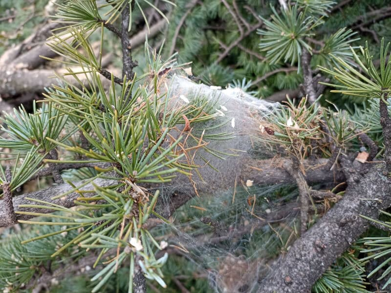

# Lotta alla processionaria a Udine e Gorizia

**Trattamenti endoterapici certificati: sicuri per famiglia e animali fino a 3 anni (entro 30 km da Palmanova)**

 

<picture>
  <source media="(max-width:460px)" srcset="{{ page.image_path }}">
  <source srcset="{{ page.webp }}" type="image/webp">
  <source srcset="{{ page.image }}" type="image/jpeg">
  
</picture>

 

La processionaria del pino (*Thaumetopoea pityocampa*) non è solo un problema estético per le piante: i suoi peli urticanti rappresentano un **serio pericolo per la salute di persone, bambini e soprattutto cani e gatti**, che rischiano gravi reazioni allergiche o necrosi della lingua anche solo annusando il terreno.

Inoltre, in Italia **la lotta alla processionaria è obbligatoria per legge** (D.M. 30 ottobre 2007) per tutti i proprietari di aree verdi in cui siano presenti pini o cedri infestati.

*Piacere, sono Enrico.* Grazie alla mia **formazione in ambito agrario** e al **patentino fitosanitario abilitante**, intervengo nelle province di **Udine e Gorizia** per proteggere i tuoi alberi e la tua famiglia in modo sicuro, mirato e duraturo.

---

## Perché scelgo l'endoterapia al posto delle irrorazioni tradizionali

Per eliminare la processionaria senza disperdere sostanze chimiche nell'aria del tuo giardino, utilizzo la tecnica dell'**endoterapia vegetale**:

* **Zero dispersione nell'ambiente:** Il principio attivo viene iniettato direttamente nel tronco dell'albero, entrando nella linfa e raggiungendo esclusivamente gli aghi di cui si nutrono le larve. Non c'è alcuna nuvola di prodotto nell'aria né contaminazione di prato, orto o giardini vicini.
* **Totale sicurezza per famiglia e animali domestici:** Bambini, cani e gatti possono frequentare subito il giardino senza alcun rischio di contatto con prodotti irrorati.
* **Protezione fino a 3 anni con un solo intervento:** A differenza dei trattamenti fogliari che vanno ripetuti ogni stagione, l'endoterapia offre una copertura efficace **fino a 2–3 anni**, risultando anche più conveniente nel tempo.
* **Efficace anche su alberi molto alti:** Non serve raggiungere la cima della chioma con getti ad alta pressione che spesso non arrivano in alto o vengono deviati dal vento.

 
<picture>
  <source srcset="/img/servizi/webp/rimozione-nidi-processionaria-alberi.webp" type="image/webp">
  <source srcset="(/img/servizi/rimozione-nidi-processionaria-alberi.jpg" type="image/jpeg">
  
</picture>
 

## Quando intervenire

* **Prevenzione con endoterapia (estate – autunno, da luglio a ottobre):** È il momento migliore e più risolutivo. Il trattamento colpisce le giovani larve fin dalla nascita, impedendo la formazione dei nidi invernali e la pericolosa discesa primaverile lungo il tronco.
* **Rimozione meccanica dei nidi (inverno):** Se i nidi bianchi sono già presenti sui rami, intervengo in quota con piattaforma aerea e dispositivi di protezione per asportarli e distruggerli in sicurezza prima che le larve scendano a terra.

---

## Richiedi un intervento sicuro per il tuo giardino

Hai pini o cedri in giardino e vuoi metterli in sicurezza prima della primavera? Contattami per un **sopralluogo gratuito entro 30 km da Palmanova**.

[Richiedi un preventivo gratuito](/contatti/) | Chiama: [**388 9005888**](tel:+393889005888) | [**Scrivimi su WhatsApp**](https://wa.me/393889005888)
