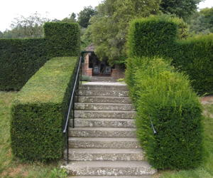

# Potatura siepi a Udine e Gorizia

 

<picture>
  <source srcset="{{ page.webp }}" type="image/webp">
  <source srcset="{{ page.image }}" type="image/jpeg">
  
</picture>

 

# Potatura siepi a Udine e Gorizia

**Siepi dritte, folte e in salute, anche oltre i 6 metri di altezza (entro 30 km da Palmanova)**

Una siepe ben curata protegge la tua privacy, valorizza la casa e mantiene il confine ordinato. Tuttavia, se viene potata nel periodo sbagliato o con attrezzature non adatte, rischia di svuotarsi alla base, ammalarsi o diventare un motivo di discussione con i vicini.

*Piacere, sono Enrico.* Con **Potasiepe** mi occupo personalmente della **potatura di siepi di ogni dimensione e specie** nelle province di **Udine e Gorizia**, garantendo un taglio netto, regolare e rispettoso della salute della pianta.

---

## Perché affidare a me la tua siepe

* **Altezze importanti senza problemi:** Intervengo anche su siepi alte **oltre i 6 metri** utilizzando trabattelli, scale professionali certificate e piattaforme aeree in piena sicurezza.
* **Disinfezione delle lame contro le malattie:** Proprio come un chirurgo disinfetta il bisturi prima di ogni intervento, **igienizzo le lame dei tagliasiepi** tra un giardino e l'altro (e tra piante malate e sane) per evitare la trasmissione di funghi e parassiti.
* **Silenzio nei centri abitati:** Quando lavoro vicino alle abitazioni utilizzo tagliasiepi **a batteria di ultima generazione**, riducendo al minimo il rumore e azzerando i fumi di scarico.
* **Attenzione ai rapporti di vicinato:** Se la tua siepe si trova sul confine, presto la massima attenzione a non invadere o sporcare la proprietà accanto e, se necessario, mi coordino volentieri con il vicino per eseguire il taglio su entrambi i lati.
* **Pulizia finale impeccabile:** A fine lavoro raccolgo ogni rametto e foglia caduta, occupandomi dello smaltimento dei residui vegetali o triturandoli per creare pacciamatura naturale.

---

## Quali siepi poto

Intervengo su tutte le principali specie presenti nei giardini friulani e isontini:

* **Siepi sempreverdi:** Lauroceraso, Fotinia (*Photinia red robin*), Leylandii, Tuia, Ligustro, Bosso, Viburno, Eleagno e Tasso.
* **Siepi spoglianti e fiorite:** Carpino, Biancospino, Ibisco, Forsizia, Spirea e siepi miste informali.

---

## Quando conviene potare la siepe

In genere consiglio **due interventi all'anno**:
1. **Tarda primavera (maggio – giugno):** per contenere la forte spinta vegetativa primaverile e dare forma compatta alla siepe.
2. **Fine estate / inizio autunno (settembre – ottobre):** per riordinare la chioma prima dell'inverno e mantenerla perfetta per tutta la stagione fredda.

## Prezzi e sopralluogo gratuito

Puoi consultare subito le tariffe indicative al metro lineare nella mia pagina [Prezzi onesti](/prezzi/). Per una stima esatta, contattami: verrò da te **entro 30 km da Palmanova** per un **sopralluogo gratuito e senza impegno**.

[Richiedi un preventivo gratuito](/contatti/) | Chiama o scrivi su WhatsApp: **388 9005888**

  
