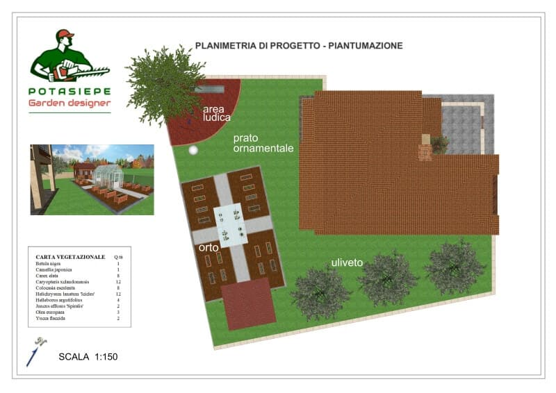
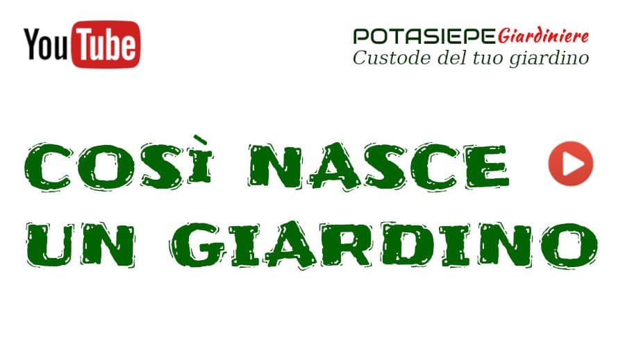

# Progettazione e realizzazione giardini a Udine e Gorizia

**Spazi verdi su misura, belli da vivere e facili da gestire nel tempo (entro 30 km da Palmanova)**

Un bel giardino non nasce mettendo a dimora qualche pianta a caso: perché resti sano, armonioso e ordinato negli anni, serve uno studio attento dell'esposizione al sole, del tipo di terreno, del clima locale e del tempo che puoi dedicare alla manutenzione.

 

 

*Piacere, sono Enrico.* Grazie alla mia **formazione universitaria in ambito agrario** e all'esperienza sul campo nelle province di **Udine e Gorizia**, progetto e realizzo giardini privati, aiuole e aree verdi aziendali che uniscono **estetica, resistenza e praticità**.

---

## Come progetto e realizzo il tuo giardino

1. **Sopralluogo e ascolto delle tue esigenze:** Camminiamo insieme nel tuo spazio verde per valutare esposizione, pendenze, punti d'acqua, privacy rispetto ai vicini e lo stile che desideri (moderno, mediterraneo, fiorito o a bassa manutenzione).
2. **Scelta botanica mirata:** Seleziono alberi, arbusti, siepi e fioriture realmente adatti al clima e al terreno del Friuli Venezia Giulia e dell'Isontino, evitando specie troppo delicate o sproporzionate per lo spazio disponibile.
3. **Preparazione del terreno e impianti:** Prima ancora di piantare, preparo il suolo in profondità, realizzo eventuali [impianti di irrigazione automatica](/irrigazione/) con scavi stretti e installo bordure pulite per delimitare aiuole e camminamenti.
4. **Messa a dimora e pacciamatura:** Pianto le essenze selezionate con le corrette distanze di crescita e rifinisco le aiuole con **pacciamatura naturale** (corteccia, cippato o lapillo) per trattenere l'umidità e ridurre la crescita delle erbacce.
5. **Formazione del prato:** Completo il lavoro con la [semina o la posa di prato a rotoli](/servizi/formazione-tappeto-erboso-e-rifacimento-prato/) per consegnarti un giardino subito ordinato e pronto da vivere.

 

  

 

## Perché affidare a me il tuo nuovo giardino

* **Un solo referente dall'idea alla realizzazione:** Non dovrai coordinare più ditte diverse: seguo personalmente ogni fase, dal progetto alla scelta delle piante fino alla posa e alla manutenzione futura.
* **Progettazione pensata per durare:** Studio combinazioni di piante che garantiscono colore e interesse in ogni stagione, riducendo al minimo gli interventi straordinari e gli sprechi d'acqua.
* **Trasparenza su tempi e costi:** Prima di iniziare i lavori ricevi un preventivo chiaro e dettagliato con tutte le voci di spesa.

---

## Hai un giardino da creare o rinnovare da zero?

Che si tratti di una nuova abitazione o di un giardino esistente da ripensare, contattami per un **sopralluogo gratuito entro 30 km da Palmanova**: trasformeremo insieme il tuo spazio esterno.

[Richiedi un preventivo gratuito](/contatti/) | Chiama: [**388 9005888**](tel:+393889005888) | [**Scrivimi su WhatsApp**](https://wa.me/393889005888)

  

<iframe class="juxtapose" width="100%" height="450" src="https://cdn.knightlab.com/libs/juxtapose/latest/embed/index.html?uid=418fbc16-9169-11ec-a554-13fc6baea232"></iframe>

