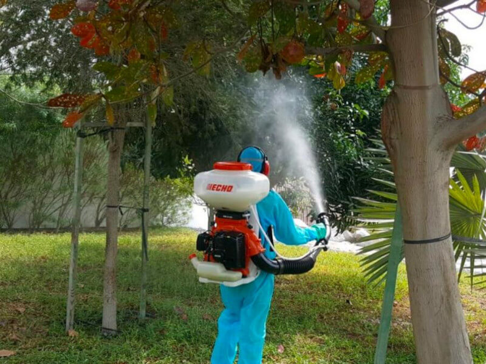

# Stop Zanzare: trattamenti mirati per il giardino

**Torna a goderti il tuo spazio verde all'aperto senza zanzare e insetti (entro 30 km da Palmanova)**

 

<picture>
  <source srcset="/img/servizi/webp/stop-zanzare-disinfestazioni-potasiepe.webp" type="image/webp">
  <source srcset="/img/servizi/stop-zanzare-disinfestazioni-potasiepe.jpg" type="image/jpeg">
  
</picture>

 

Durante la bella stagione, zanzara comune e zanzara tigre possono rendere impossibile cenare in giardino, far giocare i bambini sull'erba o rilassarsi sul terrazzo. I comuni spray o le candele spesso offrono solo un sollievo temporaneo perché non agiscono nei punti in cui le zanzare si riproducono e si nascondono.

*Piacere, sono Enrico.* In possesso di **patentino fitosanitario abilitante**, eseguo trattamenti professionali **Stop Zanzare** per giardini privati, ristoranti, hotel e aziende nelle province di **Udine e Gorizia**.

---

## Il mio metodo in due fasi per risultati concreti

Per abbattere realmente la presenza delle zanzare nel tuo giardino non basta "spruzzare nell'aria": intervengo con una strategia mirata e rispettosa dell'ambiente:

1. **Lotta larvicida nei punti di ristagno:** Tratto tombini, caditoie, griglie di scolo e sottovasi con prodotti specifici a basso impatto ambientale che bloccano lo sviluppo delle larve prima che diventino zanzare adulte.
2. **Trattamento adulticida mirato sulla vegetazione:** Nebulizzo prodotti professionali a bassa tossicità e a rapido decadimento esclusivamente nelle zone in cui le zanzare si rifugiano durante il giorno (siepi, cespugli ombreggiati, sottobosco e bordi del prato).

---

## Sicurezza, competenza e rispetto per l'ambiente

* **Prodotti autorizzati e dosaggi controllati:** Utilizzo esclusivamente formulati registrati dal Ministero della Salute per uso civile e domestico, calibrando le dosi con precisione per massimizzare l'efficacia e minimizzare l'impatto.
* **Attenzione agli insetti utili:** Eseguo i trattamenti nelle fasce orarie più adatte (primo mattino o tardo pomeriggio) ed evitando le piante in fioritura per tutelare api e impollinatori.
* **Tranquillità per famiglia e animali:** Dopo poche ore dall'asciugatura del prodotto, il giardino torna perfettamente fruibile per adulti, bambini e animali domestici.

---

## Quando conviene iniziare i trattamenti

Per mantenere il giardino protetto tutta l'estate, consiglio di iniziare tra **aprile e maggio** (con la prevenzione larvicida) e programmare interventi di mantenimento ogni **3–4 settimane** fino a settembre, oppure un trattamento mirato prima di un evento o una festa all'aperto.

 
<picture>
  <source srcset="{{ page.webp }}" type="image/webp">
  <source srcset="{{ page.image }}" type="image/jpeg">
  
</picture>
