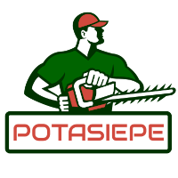

# Linee guida per l'utilizzo del brand Potasiepe

Icona di accuratezza, affidabilità ed eccellenza. Il marchio **Potasiepe** e l'emblema del giardiniere aitante, fiero e composto che impugna il tosasiepi rappresentano la mia filosofia di lavoro: competenza tecnica, serietà e cura artigianale per ogni giardino.

---

## Panoramica e titolarità

Il nome **Potasiepe**, il payoff *"Custode del tuo giardino"* e tutti gli elementi grafici collegati sono di mia esclusiva titolarità (Enrico Caputo – Il Giardiniere Potasiepe).

Per tutelare l'identità e l'affidabilità del marchio, **qualsiasi utilizzo del nome o del logo Potasiepe da parte di terzi deve essere preventivamente autorizzato per iscritto** (scrivendo a **giardiniere@potasiepe.com**) e rispettare le specifiche tecniche indicate in questa pagina.

## Slogan del brand

Lo slogan ufficiale è **"Custode del tuo giardino"** (insieme alla variante *"Custode del giardino"*). L'uso di queste espressioni in associazione al marchio Potasiepe è consentito esclusivamente previa mia approvazione esplicita.

## Logotipo Potasiepe

Il logotipo testuale accompagna tutte le comunicazioni ufficiali e deve rispettare fedelmente font, proporzioni e palette colori.

* **Font:** Audiowide
* **Colori:** Monocolore **Rosso** (`Hex #d1493d` – `RGB 209, 73, 61`) oppure **Verde chiaro** (`Hex #006400` – `RGB 0, 100, 0`)
* **Proporzioni e dimensioni:** Rapporto **1:10**, con dimensione minima per la stampa di **4 cm** di lunghezza

## Marchio figurativo Potasiepe™

Il marchio completo (emblema del giardiniere + logotipo) viene utilizzato su mezzi aziendali, abbigliamento da lavoro, documenti ufficiali e materiale promozionale.

* **Palette colori ufficiale:**
  * **Rosso:** `Hex #d1493d` – `RGB 209, 73, 61`
  * **Verde scuro:** `Hex #003200` – `RGB 0, 50, 0`
  * **Verde chiaro:** `Hex #006400` – `RGB 0, 100, 0`
* **Sfondo consigliato:** Bianco puro o comunque molto chiaro, per garantire il massimo contrasto e la piena leggibilità dell'emblema.
* **Proporzioni e dimensioni:** Rapporto **1:1**, con dimensione minima per la stampa di **4 cm** di lato.

## I domini ufficiali di Potasiepe

* [Potasiepe.it](https://www.potasiepe.it){:target="_blank" rel="noopener"}
* [Potasiepe.com](http://potasiepe.com){:target="_blank" rel="noopener"}
* [Potaalberi.it](https://www.potaalberi.it){:target="_blank" rel="noopener"}
* [Giardinierepotasiepe.it](https://www.giardinierepotasiepe.it){:target="_blank" rel="noopener"}
* [Giardinierepotasiepe.com](http://giardinierepotasiepe.com){:target="_blank" rel="noopener"}
* [Potasiepegiardiniere.it](https://www.potasiepegiardiniere.it){:target="_blank" rel="noopener"}
* [Potasiepegiardiniere.com](http://potasiepegiardiniere.com){:target="_blank" rel="noopener"}
