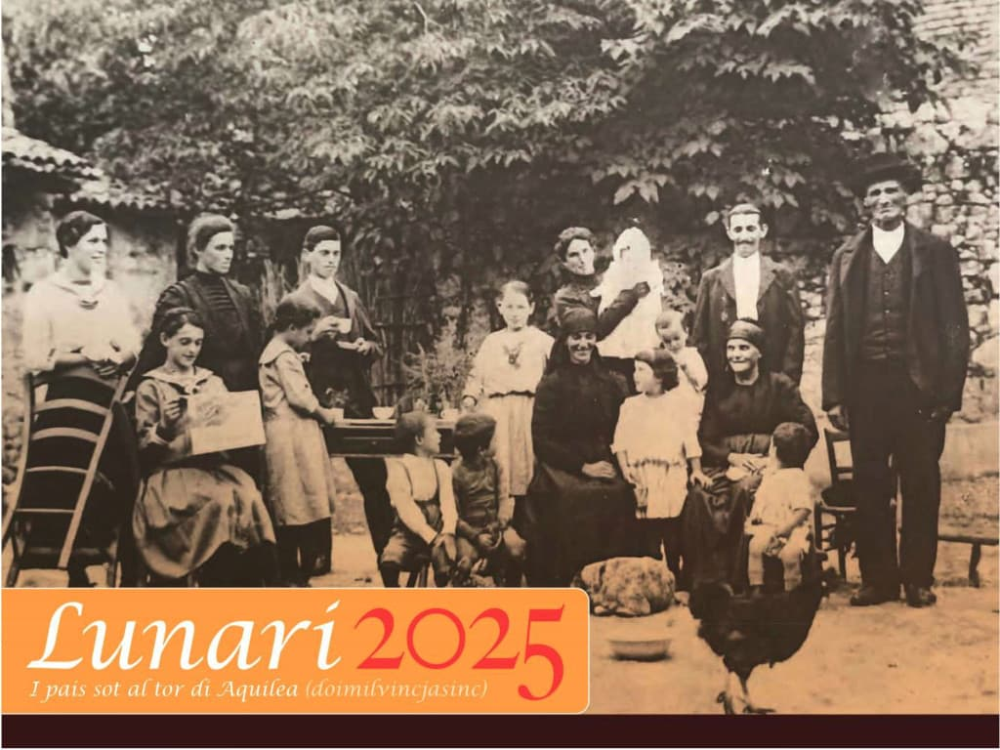

# Calendario Giardinaggio 2026

**Calendario giardinaggio 2026**: tutti i lavori di giardinaggio in orto e giardino mese per mese, calendario lunare e i miei consigli pratici per semina, trapianto, potatura e cura di piante, alberi e prato.

___

 
## Richiedi il Calendario Giardinaggio 2026
 

<cite>Lunari 2026</cite> I pais Sot al Tor di Aquileia.

 

Iscriviti alla **Newsletter** qui sotto per ricevere gratuitamente il **Calendario Giardinaggio 2026** a colori in formato PDF.

 

  <a title="Richiedi il Calendario Giardinaggio" href="#newsletter" class="button">RICHIEDILO ORA</a>

  

___

<ul>
	
		<li>
		  
			

			<h2>{{ calendario.title }}</h2>
			<a href="{{ site.baseurl }}{{ calendario.url }}"><strong>SCOPRI I CONSIGLI DEL MESE</strong> &gt;</a>
			

		</li>
	
</ul>

