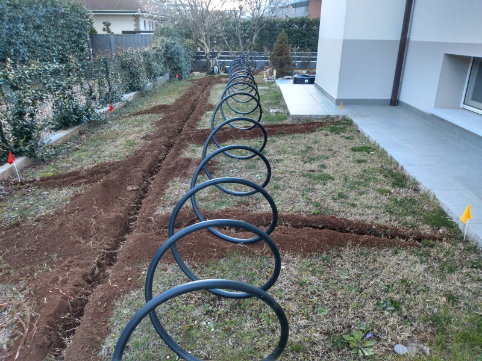
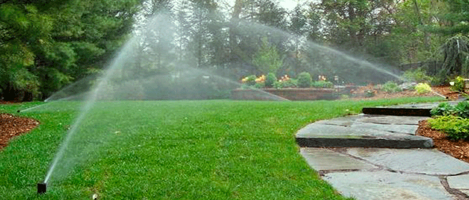

# Impianti di irrigazione giardino a Gorizia e provincia

**Progettazione e installazione impianti automatici tra Gorizia, Monfalcone, Grado e il Collio**

Chi vive nell'Isontino sa bene quanto il clima possa mettere alla prova il verde: le estati calde e ventilate tra **Monfalcone, Grado, Ronchi dei Legionari, Gradisca d'Isonzo, Cormons e Gorizia**, unite spesso a terreni molto drenanti o sassosi, richiedono un sistema d'irrigazione calibrato con precisione.

 

<picture>
  <source media="(max-width:460px)" srcset="/img/prodotti/pozzetto-irrigazione-2-400x300.jpg">
  
</picture>

 

*Piacere, sono Enrico.* Con **Potasiepe** realizzo, riparo e rimetto a nuovo **impianti di irrigazione automatici in tutta la provincia di Gorizia** (nel raggio di 30 km da Palmanova), unendo la conoscenza botanica delle piante alla tecnica idraulica più aggiornata.

---

## Impianti studiati per il clima dell'Isontino e della costa

Ogni giardino della provincia di Gorizia ha caratteristiche diverse che vanno valutate prima di posare anche un solo metro di tubo:

* **Irrigatori anti-vento per prati e giardini:** Utilizzo componenti professionali **Hunter e Rain Bird** con ugelli a pioggia pesante, ideali per evitare che le raffiche di Bora o la brezza marina disperdano l'acqua fuori dal prato o sulle facciate di casa.
* **Ala gocciolante per siepi, ulivi e giardini del Collio e del Carso:** Sui terreni pietrosi o in pendenza l'acqua tende a scivolare via velocemente; l'irrigazione a goccia rilascia l'umidità lentamente direttamente alle radici, evitando sprechi e malattie fungine.
* **Gestione da smartphone per terrazzi e seconde case a Grado:** Installo centraline smart con sensore pioggia che puoi controllare dal telefono ovunque ti trovi, perfette per chi ha una casa al mare o si assenta spesso per lavoro.

 

<picture>
  <source srcset="/img/prodotti/webp/scavo-irrigazione-giardino.webp" type="image/webp">
  <source srcset="/img/prodotti/scavo-irrigazione-giardino.jpg" type="image/jpeg">
  
</picture>

 

## Scavi poco invasivi e pozzetti facili da manutenere

Se hai già un prato avviato, non devi temere di vederlo rovinato: grazie alla **catenaria professionale**, eseguo scavi stretti e puliti che si richiudono facilmente senza lasciare solchi evidenti.

Un'attenzione particolare va ai **pozzetti delle elettrovalvole**: nella mia esperienza di manutenzione mi capita spesso di trovare pozzetti interrati male o murati in modo che diventa impossibile sostituire un pezzo senza spaccare tutto. Costruisco ogni pozzetto in modo ordinato e facilmente ispezionabile fin dal primo giorno, così qualsiasi futuro intervento sarà rapido ed economico.

---

## Riparazione guasti e check-up stagionale nell'Isontino

Intervengo regolarmente su impianti esistenti tra **Gorizia, Staranzano, San Canzian d'Isonzo, Romans d'Isonzo e Mariano del Friuli** per risolvere perdite d'acqua, sostituire elettrovalvole difettose o aggiornare vecchie centraline. A inizio e fine stagione offro anche pacchetti di **check-up completo (da 50 € a 100 €)** per controllo ugelli, pulizia filtri e programmazione.

Vuoi scoprire tutti i dettagli tecnici sul mio metodo di lavoro e sulle componenti che utilizzo? Visita la pagina dedicata ai miei [impianti di irrigazione per giardino](/prodotti/irrigazione-giardino/).

 

