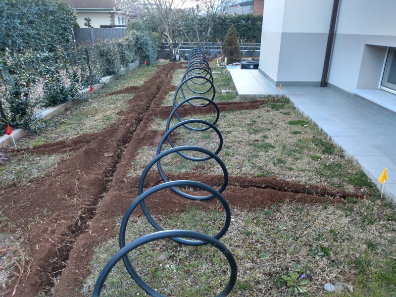
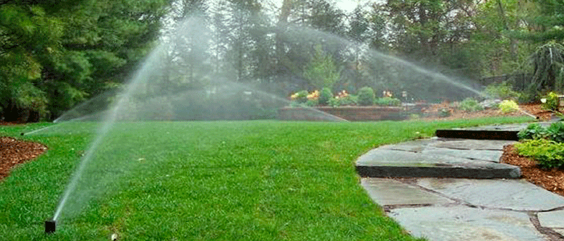

# Impianti di irrigazione giardino a Udine e provincia

**Realizzazione e manutenzione sistemi automatici interrati e a goccia (entro 30 km da Palmanova)**

Cerchi un professionista per installare o rimettere in funzione un **impianto di irrigazione in provincia di Udine**? Sono **Enrico**, titolare di **Potasiepe**, e mi occupo personalmente di progettare, installare e manutenere impianti automatici per giardini residenziali, condomini e aziende.

Con sede a **Palmanova**, intervengo rapidamente in gran parte della provincia di Udine — tra cui **Udine, Tavagnacco, Campoformido, Pasian di Prato, Codroipo, Cervignano del Friuli, Cividale del Friuli, Manzano e San Giorgio di Nogaro**.

 

<picture>
  <source media="(max-width:460px)" srcset="/img/prodotti/pozzetto-irrigazione-2-400x300.jpg">
  
</picture>

 

## Impianti affidabili e su misura per i giardini friulani

Ogni giardino ha esigenze idriche diverse in base al tipo di terreno (più drenante nell'alta pianura o più argilloso nella Bassa Friulana) e all'esposizione al sole. Per questo progetto ogni impianto partendo dalla misurazione reale di **pressione e portata dell'acqua**:

* **Irrigatori a scomparsa Hunter e Rain Bird:** Copertura uniforme del prato senza sprechi né zone ingiallite.
* **Linee a goccia per siepi e aiuole:** Ideali per siepi di fotinia, lauroceraso e fioriere, bagnano direttamente alle radici riducendo i consumi idrici.
* **Centraline con sensore pioggia:** Programmatori intuitivi che sospendono automaticamente l'irrigazione in caso di maltempo.

---

## Scavi stretti con catenaria: il tuo prato resta intatto

Anche se hai già un prato formato, posso installare l'impianto interrato senza rovinare il giardino: grazie alla **catenaria professionale**, eseguo scavi stretti e puliti che si richiudono facilmente senza lasciare solchi evidenti.

 
<picture>
  <source srcset="/img/prodotti/webp/scavo-irrigazione-giardino.webp" type="image/webp">
  <source srcset="/img/prodotti/scavo-irrigazione-giardino.jpg" type="image/jpeg">
  
</picture>
 

## Apertura, chiusura invernale e riparazioni a Udine

Eseguo interventi di **manutenzione e check-up completo** su impianti esistenti (controllo elettrovalvole, pulizia filtri, taratura irrigatori e svuotamento autunnale antigelo) con tariffe trasparenti tra **50 € e 100 €**.

---

## Richiedi un sopralluogo gratuito in provincia di Udine

Contattami per fissare una visita nel tuo giardino **entro 30 km da Palmanova** e ricevere un preventivo chiaro e senza impegno.

[Richiedi un preventivo gratuito](/contatti/) | Chiama: [**388 9005888**](tel:+393889005888) | [**Scrivimi su WhatsApp**](https://wa.me)

  

