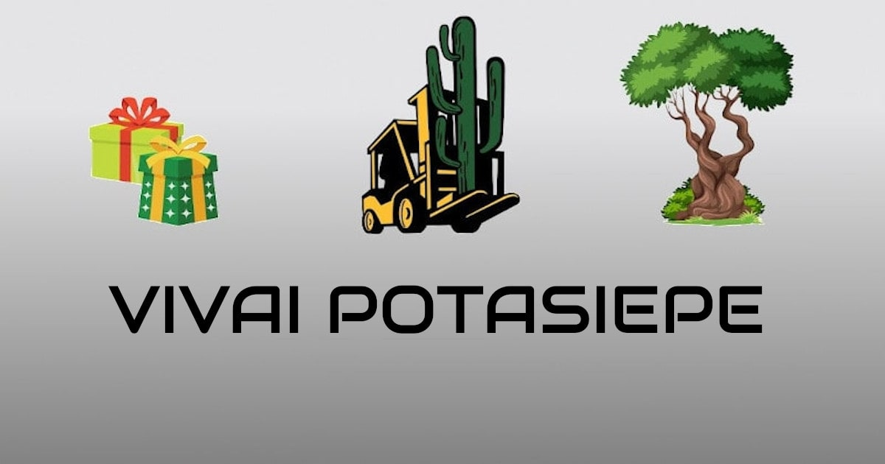

# Vivaio: aceri, ulivi, e piante da siepe

 

Seleziono e fornisco piante di acero, aceri rossi, aceri giapponesi, olivi, ulivi secolari, ulivi bonsai e piante da siepe: **piante sane, ben nutrite e protette**, pronte per essere messe a dimora nel tuo giardino.

 

  
<h2 class="text-center" id="aceri">Aceri giapponesi</h2>

<ul>

<li>
    
    

    <h3>{{ item.name }}</h3>
    
{{ item.excerpt }}

    
<strong>{{ item.price }},00 €</strong>

     
    <a title="Acquista ora {{ item.name }}" href="{{ item.link }}" class="button">Acquista ora</a>
    

     
</li>

</ul>

<h2 class="text-center" id="ulivi">Ulivi secolari</h2>

<ul>

<li>
    
    

    <h3>{{ item.name }}</h3>
    
{{ item.excerpt }}

    
<strong>{{ item.price }},00 €</strong>

     
    <a title="Acquista ora {{ item.name }}" href="{{ item.link }}" class="button">Acquista ora</a>
    

     
</li>

</ul>

<h2 class="text-center">Piante da siepe</h2>

Fornisco un vasto assortimento di piante da siepe in vaso: **fotinia**, **fillirea**, **piante sempreverdi** a crescita lenta, come il **tasso** (*Taxus baccata*), il **bosso** (*Buxus sempervirens*), l'**agrifoglio** (*Ilex aquifolium*) e il **leccio** (*Quercus ilex*), oltre a **gelsomini** grandi e piccoli, **osmanto**, **euonimus**, **lonicera**, **ligustro** e **lauroceraso**.

Scopri di più ➜ [Piante da siepe: quale scegliere](/news/siepe-quale-scegliere/ "Piante da siepe: quale scegliere")
